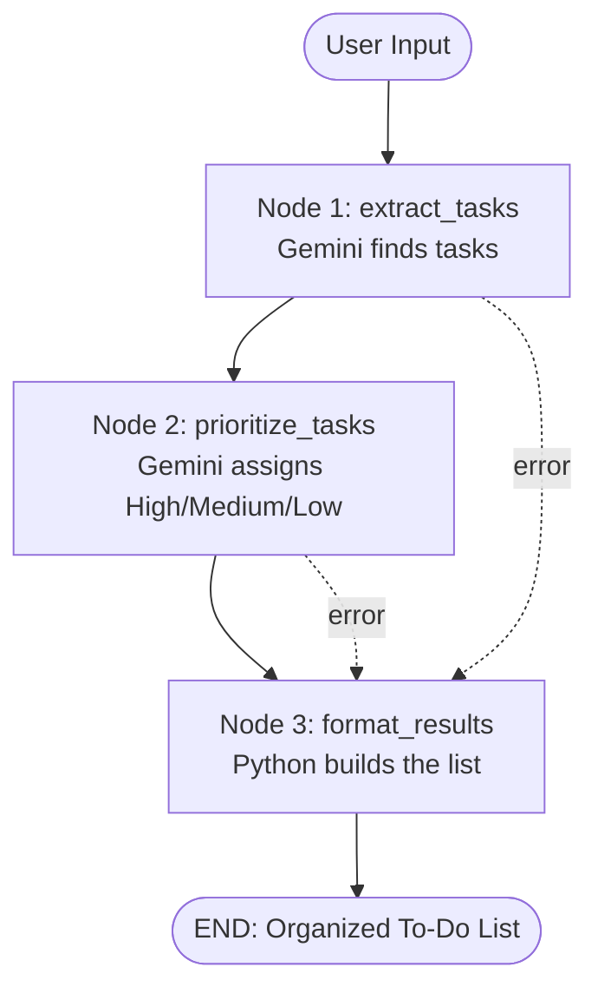

# AI-Powered Task Manager (Gemini + LangGraph)

## 1. Introduction
Type your tasks the way you would say them out loud. The app uses Google's Gemini API to
understand them and a LangGraph workflow to turn them into an organized, prioritized to-do list,
shown in a Streamlit web interface.

## 2. Problem statement
People describe tasks informally ("finish my assignment tomorrow, buy groceries today, prepare for
my meeting next week"). Turning that into a structured list with priorities is manual work.

## 3. Objectives
- Extract individual tasks, descriptions, and due-date references without inventing deadlines.
- Assign High / Medium / Low priority with a short reason.
- Present a clean list, handling missing information gracefully.
- Show friendly errors instead of fake results when the API fails.

## 4. Technology stack
| Purpose | Tool |
|---|---|
| Language | Python 3.10+ |
| Workflow | LangGraph (`StateGraph`) |
| AI | Gemini API via the official `google-genai` SDK |
| Validation | Pydantic |
| UI | Streamlit |
| Config | python-dotenv |
| Tests | pytest |

## 5. Workflow architecture

The dotted lines show that if a node sets `error` in the state, later nodes skip their work and the
UI shows the message.

### The nodes
- **Node 1 – `extract_tasks`**: sends the message to Gemini with a JSON schema (`ExtractionResult`).
  Returns title, description, due text (user's wording only), and other details. Empty input stops here.
- **Node 2 – `prioritize_tasks`**: sends the extracted tasks to Gemini (`PrioritizationResult`).
  Each task gets a priority and one-sentence reason. Every task must receive a priority.
- **Node 3 – `format_results`**: plain Python. Merges tasks and priorities, fills in
  "No description provided" / "No due date mentioned", sorts High → Medium → Low, and builds a
  Markdown version.

### Files
| File | Role |
|---|---|
| `app.py` | Streamlit UI |
| `graph.py` | Builds and compiles the LangGraph graph |
| `nodes.py` | The three nodes + state checks |
| `gemini_client.py` | Reusable Gemini wrapper and error handling |
| `schemas.py` | Pydantic models and shared `TaskState` |
| `tests/test_workflow.py` | Mocked tests + one optional real API test |

## 6. Installation (Windows + VS Code)

**Get a Gemini API key:** go to https://aistudio.google.com/apikey, sign in, click **Create API key**,
and copy it. Treat it like a password.

1. **Create the project folder** (PowerShell):
   ```powershell
   mkdir ai_task_manager
   cd ai_task_manager
   ```
   Copy all project files into this folder (keeping the `tests` and `.streamlit` subfolders).
2. **Open in VS Code:** `code .` (or File → Open Folder).
3. **Create a virtual environment** (VS Code terminal: Terminal → New Terminal):
   ```powershell
   python -m venv .venv
   ```
4. **Activate it in PowerShell:**
   ```powershell
   .\.venv\Scripts\Activate.ps1
   ```
   If you see a "running scripts is disabled" error, run this once, then retry:
   ```powershell
   Set-ExecutionPolicy -Scope CurrentUser -ExecutionPolicy RemoteSigned
   ```
   Your prompt should now start with `(.venv)`.
5. **Install packages:**
   ```powershell
   python -m pip install --upgrade pip
   pip install -r requirements.txt
   ```
6. **Create `.env`:**
   ```powershell
   Copy-Item .env.example .env
   ```
7. **Add your key:** open `.env` in VS Code and replace `your_api_key_here` with your key. Save.
   `.env` is listed in `.gitignore`, so it will not be committed.
8. **Run the app:**
   ```powershell
   streamlit run app.py
   ```
   A browser tab opens at http://localhost:8501.
9. **Test the workflow:** click **Try an example**, then **Organize My Tasks**.
10. **Run unit tests** (mocked, free, no key needed):
    ```powershell
    pytest
    ```
    Real API integration test (uses your quota):
    ```powershell
    $env:RUN_INTEGRATION = "1"
    pytest -m integration
    ```

## 7. Environment variables
| Variable | Required | Default | Meaning |
|---|---|---|---|
| `GEMINI_API_KEY` | yes | – | Your API key |
| `GEMINI_MODEL` | no | `gemini-3.8-flash` | Model name; change it if a model is retired |
| `GEMINI_TIMEOUT_SECONDS` | no | `60` | Request timeout |

Model names change. Check https://ai.google.dev/gemini-api/docs/models and update `GEMINI_MODEL`
if you get a "model not found" error.

## 8. Example
**Input**
> I need to submit my assignment tomorrow, buy groceries today, and prepare slides for next week's meeting.

**Output shape** (priorities come from the model and may vary; this is illustrative, not a recorded result)

| Task | Due | Priority | Reason |
|---|---|---|---|
| Submit assignment | tomorrow | High | Nearest deadline with academic consequences |
| Buy groceries | today | Medium | Due today, lower stakes |
| Prepare slides | next week | Low/Medium | Deadline is further away |

## 9. Troubleshooting
| Problem | Fix |
|---|---|
| `GEMINI_API_KEY is not set` | Make sure `.env` exists (not just `.env.example`) and contains your key; restart Streamlit |
| `streamlit` not recognized | Activate the venv (step 4) and rerun `pip install -r requirements.txt` |
| Script execution disabled | Run the `Set-ExecutionPolicy` command in step 4 |
| Model not found (404) | Update `GEMINI_MODEL` in `.env` |
| Rate limit / quota (429) | Wait a minute, or check your plan in Google AI Studio |
| Can't reach Gemini | Check internet, VPN, or proxy settings |
| `ModuleNotFoundError` in tests | Run `pytest` from the project root folder |

## 10. Testing notes
Unit tests replace Gemini with a fake function, so they verify our code (state handling, validation,
formatting, error paths) but **not** the real model's quality. The one test marked `integration`
calls the live API and is skipped by default.

## 11. Limitations and future improvements
- Due dates are kept as the user's wording; they are not converted to calendar dates.
- Priorities are AI judgments and may vary between runs.
- No saving of lists between sessions.
- Ideas: calendar date parsing, export to CSV, editing tasks in the UI, retry logic, saved history.
